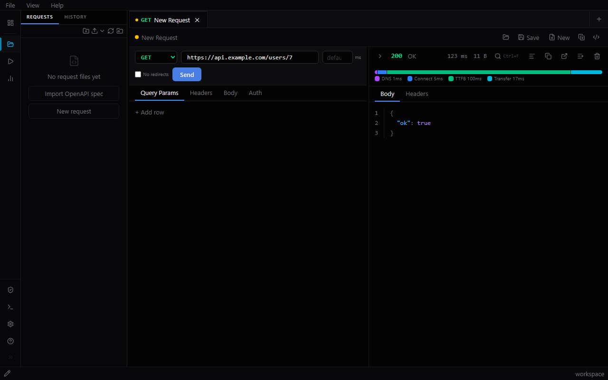

# Clear Signal

**Know when your APIs break their contracts.**

---

You ship an API. You have an OpenAPI spec. How do you actually know the implementation honours it — not just that it returns HTTP 200, but that the response body matches the declared schema, the error codes are correct, the required fields are present, and nothing has silently changed between versions?

That is the problem Clear Signal solves.

---

## See it in action


```
$ clrsig conform openapi.yaml --base-url http://localhost:8080

Conformance: Petstore API v1.0.0
  PASS  GET    /pets          200  12ms
  PASS  POST   /pets          201   8ms
  FAIL  GET    /pets/{id}     200   6ms
        └─ response body does not match schema:
           missing required field "owner"
           "price" is "string", expected "number"
  PASS  DELETE /pets/{id}     204   3ms

FAILED  3 passed, 1 failed  (29ms)
Exit code: 1
```

One command. No test files to write. The spec is the source of truth.

---

## What Clear Signal does

**Contract validation** — every HTTP response validated against your OpenAPI schema automatically. Missing fields, wrong types, undeclared status codes: all caught.

**Scenario-based conformance** — write multi-step workflows in plain YAML. Login → create resource → verify → delete. Assert state transitions, not just endpoint availability.

**Breaking change detection** — `clrsig diff v1.yaml v2.yaml` tells you exactly which changes will break clients before you ship.

**Coverage reporting** — see which operations in your spec have never been exercised, which have only been tested on the happy path, and what you have not yet proven.

**CI/CD enforcement** — JUnit output, non-zero exit codes, and a GitHub Action mean the same checks that run on your laptop block the pipeline on main.

---

## Why not just use Postman?

Postman tests what you explicitly assert. Clear Signal validates against the contract you already declared.

| | Clear Signal | Postman / Newman | Bruno | Schemathesis |
|---|:---:|:---:|:---:|:---:|
| No account required | ✓ | free tier | ✓ | ✓ |
| Local-first, file-based | ✓ | — | ✓ | ✓ |
| Git-diffable tests | ✓ | partial | ✓ | ✓ |
| Desktop GUI | ✓ | ✓ | ✓ | — |
| Multi-step scenarios | ✓ | ✓ | ✓ | — |
| OpenAPI response validation | ✓ | — | — | ✓ |
| Breaking change detection | ✓ | — | — | — |
| Operation coverage report | ✓ | — | — | partial |
| JUnit / CI output | ✓ | via Newman | ✓ | ✓ |

The closest alternative is Bruno: same local-first, git-native philosophy. The gap is contract validation — Bruno runs your requests, Clear Signal proves they conform to the spec.

---

## Install

### Desktop app

Download the latest release for your platform from [GitHub Releases](https://github.com/fuvito/api-workbench/releases/latest).

| Platform | Download |
|---|---|
| Windows | `clrsig-windows-amd64-setup.exe` |
| macOS (Apple Silicon) | `clrsig-darwin-arm64.zip` |
| macOS (Intel) | `clrsig-darwin-amd64.zip` |
| Linux | `clrsig-linux-amd64` |

> **macOS Gatekeeper:** right-click → Open → Open to approve on first launch, or run `xattr -d com.apple.quarantine clrsig-darwin-arm64`.

### CLI only

```bash
# Homebrew (macOS / Linux)
brew tap fuvito/api-workbench
brew install clrsig

# Scoop (Windows)
scoop bucket add clrsig https://github.com/fuvito/api-workbench
scoop install clrsig

# Docker
docker run --rm -v "$PWD:/workspace" ghcr.io/fuvito/api-workbench:latest \
  conform /workspace/openapi.yaml --base-url http://your-api
```

### GitHub Actions

```yaml
- uses: fuvito/api-workbench@v1
  with:
    command: conform
    spec: openapi.yaml
    base-url: http://localhost:8080
    format: junit
    output: test-results/conform.xml
```

---

## Workflow in 60 seconds

```bash
# 1. Point at your spec
clrsig conform openapi.yaml --base-url http://localhost:8080

# 2. Write a scenario (or generate one)
clrsig generate openapi.yaml --output scenarios/

# 3. Run the scenario with spec validation
clrsig run scenarios/user-lifecycle.yaml \
  --env environments/local.yaml \
  --spec openapi.yaml \
  --coverage

# 4. Catch a breaking change before it ships
clrsig diff openapi-v1.yaml openapi-v2.yaml --breaking-only
```

All commands exit `0` on pass, `1` on violations, `2` on config errors — ready to gate any CI pipeline.

---

## Scenarios are plain YAML

```yaml
schemaVersion: "1"
title: User lifecycle
specFile: ./openapi.yaml

steps:
  - label: Login
    method: POST
    url: "{{baseUrl}}/auth/login"
    body:
      type: json
      content: '{"username":"admin","password":"{{password}}"}'
    assertions:
      - { type: status, operator: eq, expected: 200 }
    extractions:
      - { name: token, source: jsonpath, path: $.token }

  - label: Create user
    method: POST
    url: "{{baseUrl}}/users"
    headers:
      - { name: Authorization, value: "Bearer {{token}}" }
    assertions:
      - { type: status,   operator: eq,       expected: 201 }
      - { type: jsonpath, path: $.id,          operator: ne, expected: "" }
      - { type: schema }   # validates full response body against openapi.yaml
```

Version-controlled. Reviewed in pull requests. Run identically on a laptop and in CI.

---

## Local-first. No account. No cloud.

API traffic stays on your machine. Project files are YAML you own and can commit to git. The desktop app and CLI share the same execution engine — there is no "sync" step, no cloud state, no account required to use any feature.

---

## Screenshots

| Request editor | Scenario results |
|---|---|
|  |  |

---

## Contributing and developer docs

See [README-DEVELOPER.md](README-DEVELOPER.md) for build instructions, project structure, test commands, architecture rules, and release procedures.

---

## License

[MIT](LICENSE)
