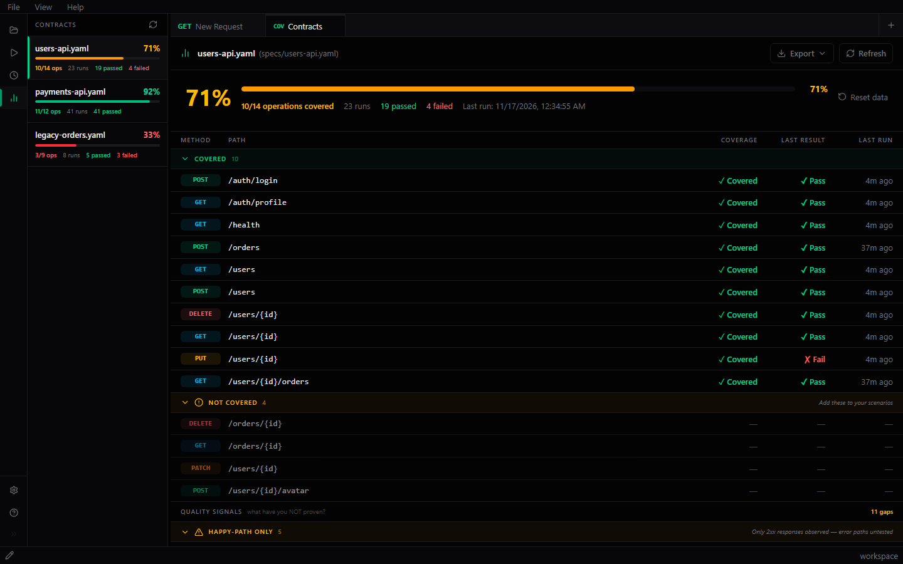
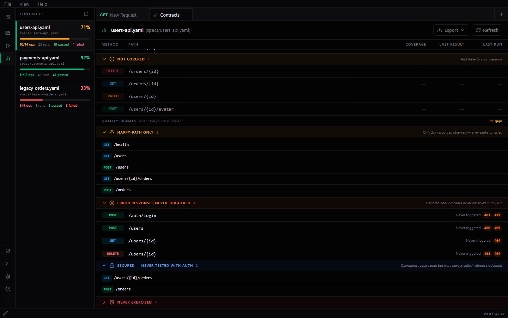
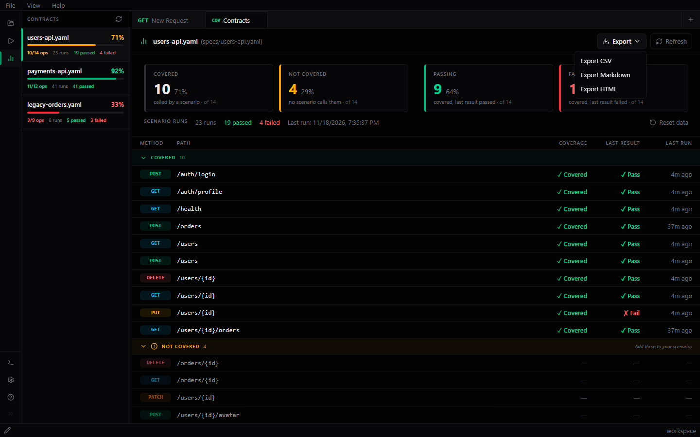
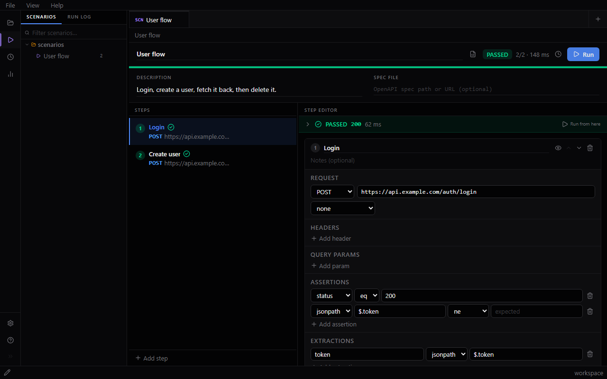

# Clear Signal

**Know when your APIs break their contracts.**

---

You ship an API. You have an OpenAPI spec. How do you actually know the implementation honours it — not just that it returns HTTP 200, but that the response body matches the declared schema, the error codes are correct, the required fields are present, and nothing has silently changed between versions?

That is the problem Clear Signal solves.

---

## See it in action


```
$ clrsig conform openapi.yaml --base-url http://localhost:8080

Conformance: Petstore API v1.0.0
  PASS  GET    /pets          200  12ms
  PASS  POST   /pets          201   8ms
  FAIL  GET    /pets/{id}     200   6ms
        └─ response body does not match schema:
           missing required field "owner"
           "price" is "string", expected "number"
  PASS  DELETE /pets/{id}     204   3ms

FAILED  3 passed, 1 failed  (29ms)
Exit code: 1
```

One command. No test files to write. The spec is the source of truth.

---

## What Clear Signal does

**Contract validation** — every HTTP response validated against your OpenAPI schema automatically. Missing fields, wrong types, undeclared status codes: all caught.

**Scenario-based conformance** — write multi-step workflows in plain YAML. Login → create resource → verify → delete. Assert state transitions, not just endpoint availability.

**Breaking change detection** — `clrsig diff v1.yaml v2.yaml` tells you exactly which changes will break clients before you ship.

**The Contracts page** — a live scorecard for every OpenAPI spec you test: per-operation coverage and last result, plus quality signals that show what you have *not* proven yet. [See below.](#the-contracts-page)

**Impact analysis** — `clrsig impact v1.yaml v2.yaml scenarios/*.yaml` tells you which of your scenarios will stop passing when a spec change ships.

**Negative-path checks** — `clrsig conform --negative` also probes with missing required fields, wrong types, missing auth and missing parameters, to confirm the API rejects what the spec says it must reject.

**AI-ready** — generate a whole test suite from an OpenAPI document with the built-in AI prompt and import it as a single bundle, or let an AI agent call `clrsig` directly through its MCP server (`clrsig mcp`).

**Coverage reporting** — see which operations have never been exercised, which have only been tested on the happy path, which error codes have never been triggered, and which secured routes have never been called with credentials. Export as CSV, Markdown, or HTML.

**CI/CD enforcement** — JUnit output, non-zero exit codes, and a GitHub Action mean the same checks that run on your laptop block the pipeline on main. Add `--format html` for a self-contained report anyone can open from the build artifacts.

---

## The Contracts page

Passing tests tell you what works. The **Contracts** page tells you what you have never checked.

Every time a scenario runs against an OpenAPI spec, Clear Signal maps each request to the spec operation it exercised and records whether it passed. Those results accumulate across runs, so the page becomes a running picture of how well your tests cover the contract you declared.



**One card per spec.** The sidebar lists every spec you have tested with its coverage percentage, operations covered, and passed/failed run counts. Green at 80% and above, amber at 40% and above, red below.

**Totals that cannot flatter you.** Four equal tiles at the top count *Covered* and *Not covered* operations, then *Passing* and *Failing* ones among the covered, each with its share of the spec. Full coverage with a failing operation shows up as exactly that, not as a green bar.

**Every operation, at a glance.** The main view lists each operation in the spec as *Covered* or *Not covered*, with the result of the most recent run that hit it. A failing operation (`PUT /users/{id}` above) stands out immediately, and so does one nobody has tested.

### Quality signals: what have you *not* proven?

A 100% coverage number can still hide a lot. Below the operation table, four collapsible signals point at the gaps that coverage alone misses:

| Signal | What it tells you |
|---|---|
| **Happy-path only** | Only 2xx responses have ever been observed. Nobody has tested what happens when it goes wrong. |
| **Error responses never triggered** | The spec declares `400`, `404`, `409`… for this operation, but no run has ever produced them. Each missing code is listed. |
| **Secured — never tested with auth** | The spec says the operation needs credentials, yet every call so far was made without any. |
| **Never exercised** | No recorded run has reached this operation at all. |



Each row names the operation and, for error gaps, the exact status codes to go and trigger. It works as a to-do list for your next scenario.

### Share it

**Export** produces a CSV, a Markdown report (paste it into a pull request or wiki), or a print-ready HTML report. Reports open with the same four totals as the page (Covered, Not covered, Passing, Failing), followed by the operation table and every quality gap. The command-line `coverage list` and `coverage quality` carry the same totals in text and JSON.



### Turn it on

Point a scenario at its spec and run it. Coverage accumulates automatically:

```yaml
schemaVersion: "1"
title: User lifecycle
specFile: ./openapi.yaml
```

The page refreshes after every run. The CLI reads the same data from the workspace:

```bash
clrsig run scenarios/user-lifecycle.yaml --spec openapi.yaml --workspace . --coverage
clrsig coverage list    --workspace .
clrsig coverage quality openapi.yaml --workspace .
```

Contracts data lives in your workspace, never in the cloud. **Reset data** clears a spec's history whenever you want a fresh baseline.

---

## Why not just use Postman?

Postman tests what you explicitly assert. Clear Signal validates against the contract you already declared.

| | Clear Signal | Postman / Newman | Bruno | Schemathesis |
|---|:---:|:---:|:---:|:---:|
| No account required | ✓ | free tier | ✓ | ✓ |
| Local-first, file-based | ✓ | — | ✓ | ✓ |
| Git-diffable tests | ✓ | partial | ✓ | ✓ |
| Desktop GUI | ✓ | ✓ | ✓ | — |
| Multi-step scenarios | ✓ | ✓ | ✓ | — |
| OpenAPI response validation | ✓ | — | — | ✓ |
| Breaking change detection | ✓ | — | — | — |
| Operation coverage report | ✓ | — | — | partial |
| JUnit / CI output | ✓ | via Newman | ✓ | ✓ |

The closest alternative is Bruno: same local-first, git-native philosophy. The gap is contract validation — Bruno runs your requests, Clear Signal proves they conform to the spec.

**What about Dredd and Prism?** Focused OpenAPI validators exist. Dredd replays your spec's example requests and checks responses; Prism can mock a server or proxy requests and flag schema violations. If raw spec validation in CI is all you need, either works. Clear Signal goes further: multi-step scenarios let you test stateful flows (login → create → verify → delete) that single-request replayers cannot express, the coverage report shows which operations have never been exercised, `clrsig diff` flags breaking changes before you ship, and the desktop GUI makes all of it accessible without leaving the tool. If you are already happy with Dredd or Prism for smoke-testing, Clear Signal is the layer you add when "it validates" is no longer enough.

---

## How this differs from Pact and consumer-driven contract testing

Developers searching for "contract testing" tools will find Pact. Clear Signal solves a different problem.

**Consumer-driven contract testing (Pact)** is a collaboration protocol between microservices teams. The consumer team writes a contract describing what it expects from the provider, publishes it to a broker, and the provider's CI verifies it can satisfy every consumer's expectations. It is team-coordination tooling. It requires both sides to adopt the same framework and broker infrastructure. It works best when you own both the consumer and the provider.

**Clear Signal is provider-side, spec-driven validation.** You have an OpenAPI specification — a document you already wrote and ship. Clear Signal executes your API and verifies that every response matches what the spec declares: required fields present, types correct, error codes as declared. No consumer team needed. No broker. No framework adoption on either side. The spec *is* the contract.

| Question | Pact | Clear Signal |
|---|---|---|
| Who writes the contract? | Consumer team | You write an OpenAPI spec |
| What is validated? | Consumer expectations against the provider | Provider responses against its own spec |
| Requires both sides to adopt the tool? | Yes | No — spec-only on the provider side |
| Works with third-party or public APIs? | No | Yes — any API with an OpenAPI spec |
| Breaking change detection across versions? | Via pact-broker | `clrsig diff v1.yaml v2.yaml` |
| Works in CI without coordination? | Needs a shared broker | Single command, single spec file |

The two approaches are complementary, not competing. If you have a mature microservices estate with consumer-driven contracts in Pact, Clear Signal adds a second layer: it catches spec violations that no consumer has yet tested for, and it validates third-party and public APIs where you have no consumer contract at all.

---

## Install

### Desktop app

Download the latest release for your platform from [GitHub Releases](https://github.com/fuvito/api-workbench/releases/latest).

| Platform | Download |
|---|---|
| Windows | `clrsig-windows-amd64-setup.exe` |
| macOS (Apple Silicon) | `clrsig-darwin-arm64.zip` |
| macOS (Intel) | `clrsig-darwin-amd64.zip` |
| Linux | `clrsig-linux-amd64` |

> **macOS Gatekeeper:** right-click → Open → Open to approve on first launch, or run `xattr -d com.apple.quarantine clrsig-darwin-arm64`.

### CLI only

```bash
# Homebrew (macOS / Linux)
brew tap fuvito/api-workbench
brew install clrsig

# Scoop (Windows)
scoop bucket add clrsig https://github.com/fuvito/api-workbench
scoop install clrsig

# Docker
docker run --rm -v "$PWD:/workspace" ghcr.io/fuvito/api-workbench:latest \
  conform /workspace/openapi.yaml --base-url http://your-api
```

### GitHub Actions

```yaml
- uses: fuvito/api-workbench@v1
  with:
    command: conform
    spec: openapi.yaml
    base-url: http://localhost:8080
    format: junit
    output: test-results/conform.xml
```

---

## Try it in under two minutes

The repo includes a working demo server and a full example scenario set. Clone it and run:

```bash
git clone https://github.com/fuvito/api-workbench
cd api-workbench

# Start the included demo API server
go run ./examples/server &

# Validate every declared operation conforms to the spec
clrsig conform examples/server/openapi.yaml \
  --base-url http://localhost:8080 \
  --env examples/environments/demo-conform.yaml

# Run the multi-step scenario: login → create → fetch → delete
clrsig run examples/scenarios/user-lifecycle.yaml \
  --env examples/environments/local.yaml

# Detect a breaking change before it ships
clrsig diff examples/specs/users-api-v1.yaml \
  examples/specs/users-api-v2.yaml \
  --breaking-only
```

These three commands are run in CI on every push — they cannot silently rot.

---

## Workflow against your own API

```bash
# 1. Point at your spec
clrsig conform openapi.yaml --base-url http://localhost:8080

# 2. Generate a request file for every operation, then build scenarios from them
clrsig generate openapi.yaml --output requests/

# 3. Run the scenario with spec validation
clrsig run scenarios/user-lifecycle.yaml \
  --env environments/local.yaml \
  --spec openapi.yaml \
  --coverage

# 4. Catch a breaking change before it ships
clrsig diff openapi-v1.yaml openapi-v2.yaml --breaking-only
```

All commands exit `0` on pass, `1` on violations, `2` on config errors — ready to gate any CI pipeline.

---

## Scenarios are plain YAML

```yaml
schemaVersion: "1"
title: User lifecycle
specFile: ./openapi.yaml

steps:
  - label: Login
    request:
      method: POST
      url: "{{baseUrl}}/auth/login"
      body:
        type: json
        content: '{"username":"admin","password":"{{password}}"}'
    assertions:
      - { type: status, operator: eq, expected: 200 }
    extractions:
      - { name: token, source: jsonpath, path: $.token }

  - label: Create user
    request:
      method: POST
      url: "{{baseUrl}}/users"
      headers:
        - { name: Authorization, value: "Bearer {{token}}" }
    assertions:
      - { type: status,   operator: eq,       expected: 201 }
      - { type: jsonpath, path: $.id,          operator: ne, expected: "" }
      - { type: schema }   # validates full response body against openapi.yaml
```

Version-controlled. Reviewed in pull requests. Run identically on a laptop and in CI.

---

## Local-first. No account. No cloud.

API traffic stays on your machine. Project files are YAML you own and can commit to git. The desktop app and CLI share the same execution engine — there is no "sync" step, no cloud state, no account required to use any feature.

---

## Screenshots

| Request editor | Scenario results |
|---|---|
|  |  |

| Contracts overview | Contracts quality signals |
|---|---|
|  |  |

Light-theme versions of every Contracts image are in [`docs/images`](docs/images) (`*-light.png`).

---

## Contributing and developer docs

See [README-DEVELOPER.md](README-DEVELOPER.md) for build instructions, project structure, test commands, architecture rules, and release procedures.

---

## License

[MIT](LICENSE)
