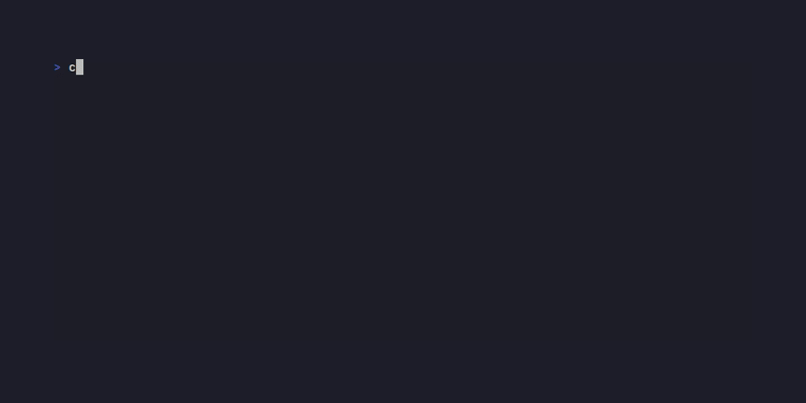
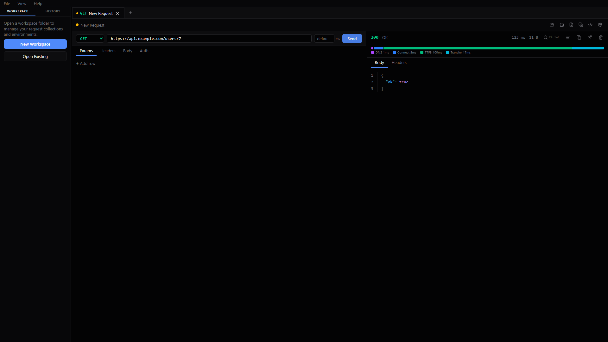
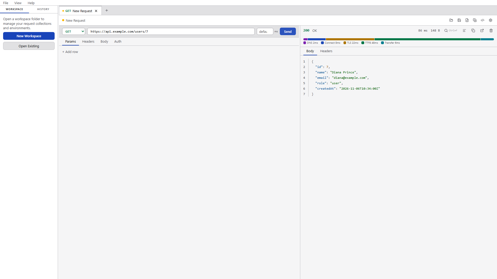
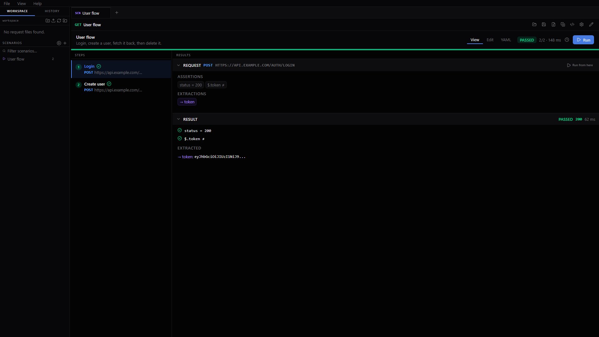
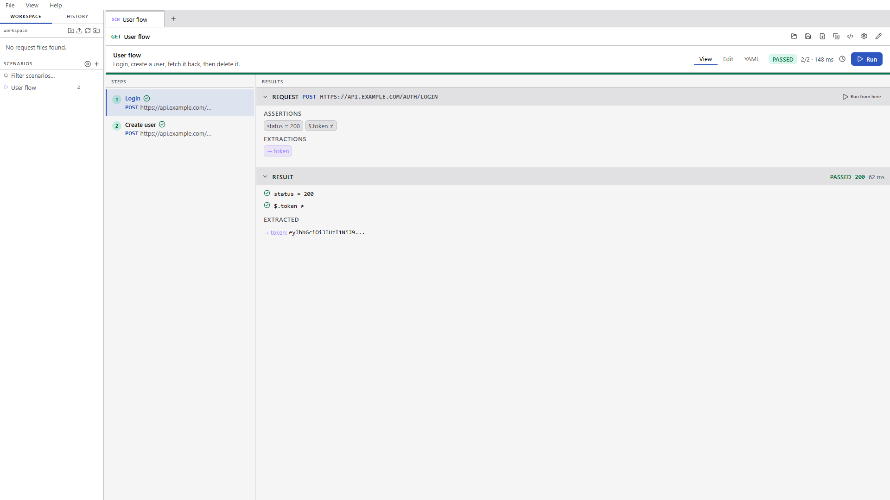
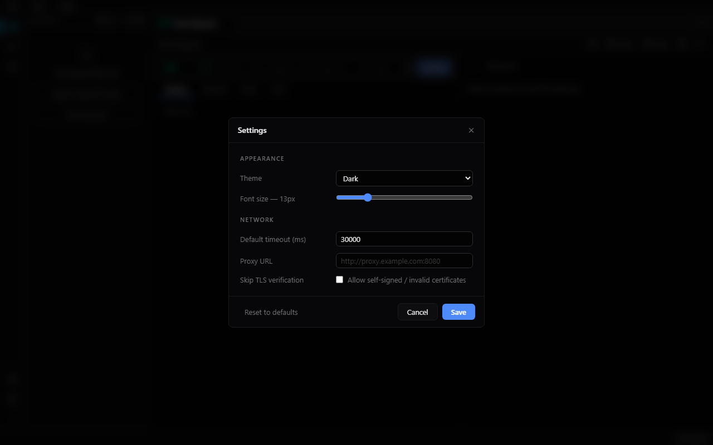
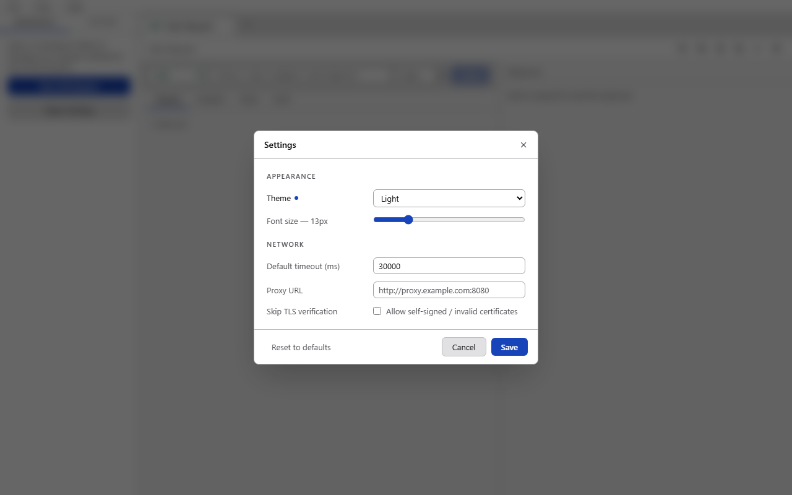

# Clear Signal

**API Contract Validation and Spec Conformance Testing — with a full API development workbench.**

Clear Signal is an open-source, local-first desktop application that lets you verify APIs conform to their declared contracts (OpenAPI specifications, schema assertions, and response validation), detect breaking changes, and enforce conformance in CI/CD pipelines — all without a cloud account.

> **Status:** Phases 0–5 complete — public MVP. The desktop app, full HTTP client, workspace management, OpenAPI import, scenario engine + CLI, settings, timing breakdown, and cross-platform release workflow are all working. Recent additions: Ctrl+P quick open, env-var autocomplete, collapsible response panel, and tab overflow indicators.

---

## Demo



> _Auto-generated by CI from [`docs/demo.tape`](docs/demo.tape). Re-runs whenever the tape or CLI source changes._

---

## Screenshots

| Dark mode | Light mode |
|---|---|
|  |  |
|  |  |
|  |  |

---

## Why Clear Signal

Most API tools focus on exploration. Clear Signal focuses on **contract verification**: does your API actually honour its OpenAPI specification? Can you prove it, repeatably, in a pipeline?

- **API Contract Validation** — validate that actual HTTP responses match declared OpenAPI schemas.
- **Spec Conformance Testing** — run scenario-based tests that enforce your API contract across a full user workflow.
- **Local-first** — no mandatory account, no cloud sync, no data leaving your machine.
- **Git-native** — all project definitions are plain YAML or JSON files. Version-control them like code.
- **CLI and GUI parity** — the same Go execution engine powers both. Run the same tests interactively or in GitHub Actions.
- **Productive workbench** — Ctrl+P quick open, `{{` env-var autocomplete, collapsible response panel, and tab overflow indicators keep you in flow as collections grow.

---

## How Clear Signal compares

| | Clear Signal | Bruno | Postman/Newman | Schemathesis |
|---|:---:|:---:|:---:|:---:|
| No account required | ✓ | ✓ | free tier | ✓ |
| Local-first, file-based | ✓ | ✓ | — | ✓ |
| Git-diffable tests | ✓ | ✓ | partial | ✓ |
| Desktop GUI | ✓ | ✓ | ✓ | — |
| Multi-step scenarios | ✓ | ✓ | ✓ | — |
| OpenAPI response validation | ✓ | — | — | ✓ |
| Breaking change detection (`diff`) | ✓ | — | — | — |
| JUnit / CI output | ✓ | ✓ | via Newman | ✓ |
| GitHub Action | ✓ | — | via Newman | ✓ |

Clear Signal's differentiators over Bruno (the closest alternative): spec conformance validation and explicit breaking-change detection, while keeping the same local-first, git-native philosophy. Over Schemathesis: a full GUI, human-authored scenarios, and variable extraction — without the property-based fuzzing noise.

---

## Install the CLI

The `clrsig` CLI works independently of the desktop app.

### Homebrew (macOS / Linux)

```bash
brew tap fuvito/api-workbench
brew install clrsig
```

### Scoop (Windows)

```powershell
scoop bucket add clrsig https://github.com/fuvito/api-workbench
scoop install clrsig
```

### Download a binary

Download the latest release from [GitHub Releases](https://github.com/fuvito/api-workbench/releases/latest):

| Platform | File |
|---|---|
| Linux (amd64) | `clrsig-linux-amd64` |
| macOS (Intel) | `clrsig-darwin-amd64.zip` |
| macOS (Apple Silicon) | `clrsig-darwin-arm64.zip` |
| Windows — installer | `clrsig-windows-amd64-setup.exe` — installs to Program Files, creates Start Menu and Desktop shortcuts |
| Windows — portable | `clrsig.exe` — run anywhere without installing |

> **macOS note:** release binaries are unsigned. On first launch, macOS Gatekeeper will block the binary with *"cannot be opened because the developer cannot be verified."*
> To allow it, run:
> ```bash
> xattr -d com.apple.quarantine clrsig-darwin-arm64   # or amd64
> chmod +x clrsig-darwin-arm64
> ```
> Alternatively, right-click the file in Finder → **Open** → **Open** to approve it once.

### Docker

```bash
docker run --rm \
  -v "$PWD:/workspace" \
  ghcr.io/fuvito/api-workbench:latest \
  run /workspace/tests/my-scenario.yaml --env /workspace/environments/ci.yaml
```

### GitHub Actions

```yaml
- uses: fuvito/api-workbench@v1
  with:
    command: conform
    spec: openapi.yaml
    base-url: http://localhost:8080
    coverage: 'true'
```

See [`clrsig-action/README.md`](clrsig-action/README.md) for all commands, inputs, and examples.

---

## Tech Stack

| Layer | Technology |
|---|---|
| Core engine | Go 1.26 |
| Desktop | Wails v2 |
| Frontend | React 19 + TypeScript 7 + Vite 8 |
| UI | Tailwind CSS v4 + shadcn/ui |
| CLI | Cobra |
| Project files | YAML + JSON |
| API specification | OpenAPI 3.0 / 3.1 + Swagger 2.0 |
| History | SQLite |
| Package manager | pnpm 9 (frontend), Go workspace (backend) |

---

## Prerequisites

| Tool | Version |
|---|---|
| Go | 1.26+ |
| Node.js | 22+ |
| pnpm | 9+ |
| Wails CLI | v2 (`go install github.com/wailsapp/wails/v2/cmd/wails@latest`) |

Wails also requires a C compiler on the host. On Windows, [TDM-GCC](https://jmeubank.github.io/tdm-gcc/) or [MSYS2](https://www.msys2.org/) works. See the [Wails prerequisites guide](https://wails.io/docs/gettingstarted/installation) for platform-specific setup.

---

## Quick Start

```bash
git clone https://github.com/fuvito/api-workbench.git
cd api-workbench

# Install frontend dependencies
pnpm install --dir apps/desktop/frontend

# Launch the desktop app (dev mode with hot reload)
cd apps/desktop/wails
wails dev
```

The application opens automatically. Type a URL in the request bar and press **Send** or **Enter**.

### Run the example server locally

```bash
# In a separate terminal
cd examples/server
go run .
# Listening on :8080 — includes /health, /users CRUD, /auth/login, /protected
```

### Run a scenario with the CLI

```bash
cd apps/cli
go run . run ../../examples/scenarios/user-lifecycle.yaml --env ../../examples/environments/local.yaml
```

### Import an OpenAPI spec

Open the desktop app → open a workspace → click **Import OpenAPI** in the workspace panel → select `examples/server/openapi.yaml`. All operations are saved as individual request files and appear in the workspace tree.

---

## CLI Reference

The `clrsig` CLI exposes six commands. All commands support `--format json` for machine-readable output and `--output <file>` to write results to disk instead of stdout.

### `run` — execute a scenario

```bash
clrsig run <scenario-file> [flags]

  -e, --env <file>       Environment file (YAML or JSON)
  -s, --spec <file>      OpenAPI spec to validate responses against
      --coverage         Report which spec operations the scenario exercised
  -f, --format           Output format: text (default), json, junit
  -o, --output <file>    Write report to file
      --timeout <ms>     Global step timeout (overrides per-step setting)
```

**Example — scenario with spec validation and coverage:**

```bash
clrsig run scenarios/user-lifecycle.yaml \
  --env environments/local.yaml \
  --spec openapi.yaml \
  --coverage
```

```
Scenario: User lifecycle
  PASS  Login  200  18ms
  PASS  Create user  201  4ms
  PASS  Fetch user  200  2ms
  PASS  Delete user  204  1ms

PASSED  4 passed, 0 failed, 0 skipped  (9/9 assertions passed)  25ms

Spec coverage: 4 / 8 operations (50%)

Covered:
  POST    /auth/login
  POST    /users
  DELETE  /users/{id}
  GET     /users/{id}

Not covered:
  GET     /health
  GET     /protected
  GET     /users
  PUT     /users/{id}
```

You can also embed the spec path in the scenario YAML with `specFile: ./openapi.yaml` so it loads automatically without the flag.

**Exit codes:** `0` = all passed · `1` = assertion failures · `2` = parse or config error

---

### `conform` — run all spec operations against a live server

Generates a request for every operation declared in the spec, executes them, and validates each response against the spec's declared schema.

```bash
clrsig conform <spec-file-or-url> [flags]

  -b, --base-url <url>       Server to send requests to (overrides spec servers[0])
  -e, --env <file>           Environment file for variable resolution
      --tags <tag1,tag2>     Only run operations with these tags
      --paths </prefix>      Only run operations whose path starts with this prefix
      --coverage             Append coverage summary
      --fail-fast            Stop after first violation
      --request-timeout <ms> Per-request timeout (default 10 000)
  -f, --format               text (default), json, junit
  -o, --output <file>        Write report to file
```

```bash
# Run against the local example server
clrsig conform examples/server/openapi.yaml \
  --base-url http://localhost:8080 \
  --coverage

# Fetch the spec from a URL
clrsig conform https://petstore.swagger.io/v2/swagger.json \
  --base-url https://petstore.swagger.io/v2 \
  --env environments/petstore.yaml
```

**Exit codes:** `0` = all conformed · `1` = violations or execution failures · `2` = parse error

---

### `diff` — detect breaking changes between two specs

```bash
clrsig diff <base-spec> <revision-spec> [flags]

      --breaking-only    Only report breaking changes
  -f, --format           text (default), json, junit
  -o, --output <file>    Write report to file
```

```bash
clrsig diff openapi-v1.yaml openapi-v2.yaml
clrsig diff openapi-v1.yaml openapi-v2.yaml --breaking-only --format junit --output diff-report.xml
```

**Sample output** (v1 → v2: `POST /users` removed, `GET /users/{id}` added):

```
Spec diff: Users API v1.0.0 → v2.0.0
──────────────────────────────────────────────────
✗ [ERR] api removed without deprecation
✓ [INFO] endpoint added
──────────────────────────────────────────────────
Result: BREAKING CHANGES DETECTED (2 total changes)
```

**Exit codes:** `0` = no breaking changes · `1` = breaking changes found · `2` = parse error

**Integration test** — the diff check is exercised in-process in the example server test suite:

```bash
go test -v -run TestSpecDiff ./examples/server
```

---

### `generate` — write request files from a spec

```bash
clrsig generate <spec-file-or-url> [flags]

  -b, --base-url <url>   Override base URL from spec
  -o, --output <dir>     Output directory (default: ./<spec-title>/)
  -f, --format           text (default) or json
      --dry-run          Print what would be generated without writing files
```

```bash
clrsig generate openapi.yaml --output requests/
clrsig generate https://petstore.swagger.io/v2/swagger.json --dry-run
```

---

### `request` — execute a single request file

```bash
clrsig request <request-file> [flags]

  -e, --env <file>       Environment file
      --timeout <ms>     Request timeout
  -f, --format           text (default) or json
```

```bash
clrsig request requests/users/get-users.yaml --env environments/staging.yaml
```

---

### `validate` — check scenario files for errors without executing them

```bash
clrsig validate <scenario-file> [file2...] [flags]

  -f, --format   text (default) or json
  -o, --output   Write report to file
```

```bash
clrsig validate scenarios/*.yaml
```

---

## How Workspaces Work

Clear Signal organises requests as **plain YAML files on disk** — not in a proprietary binary format, not in a database. This means your collection is fully version-controllable with git, diffable in any editor, and portable across machines.

### Folder structure

```
my-workspace/
├── environments/
│   ├── local.yaml          # Environment variables for local development
│   └── staging.yaml
└── requests/
    ├── health-check.yaml   # Individual request files
    ├── auth/
    │   ├── login.yaml
    │   └── refresh-token.yaml
    └── users/
        ├── list-users.yaml
        └── create-user.yaml
```

- `environments/` — variable sets (base URL, auth tokens, etc.). Select the active environment from the top bar.
- `requests/` — one YAML file per request; subdirectories are folders in the sidebar tree.

### Name = filename

**The request's name is its filename.** When you save a request named `List Users`, it writes to `list-users.yaml`. Renaming the request (click the name in the header, type a new name, Ctrl+S) renames the file automatically — no separate "Save As" dialog, no filename-vs-name mismatch.

Uniqueness is enforced at save time: two requests in the same folder cannot share a name, because they would map to the same file. If a conflict is detected, an error is shown inline in the header and no file is written.

### Dirty state

An **amber dot** appears in the header whenever the current request has unsaved changes. The same dot appears on the file in the workspace sidebar. Navigating away (opening another file, clicking New Request, switching history) triggers a confirmation dialog with three choices: **Save & Continue**, **Discard**, or **Cancel**.

### File format

Each request file is human-readable YAML:

```yaml
schemaVersion: "1"
name: List Users
method: GET
url: "{{baseUrl}}/users"
headers:
  - name: Accept
    value: application/json
queryParams:
  - name: page
    value: "1"
```

You can edit these files directly in any text editor. `{{variable}}` references are resolved against the active environment at request time.

---

## Development

### Run all Go tests

```bash
# Core packages — from the repo root
go test ./packages/core/...

# Integration tests — spins up an in-process httptest server, runs the
# user-lifecycle scenario, and verifies spec coverage (no external process needed)
go test -v -run TestScenarioCoverage ./examples/server
```

### Run frontend unit tests

```bash
cd apps/desktop/frontend
pnpm test
```

### Run E2E tests (Playwright, mocked frontend)

```bash
cd apps/desktop/e2e
pnpm install
npx playwright install chromium
pnpm test
```

### Run E2E smoke tests (against live `wails dev`)

```bash
# In one terminal: start the app
cd apps/desktop/wails && wails dev

# In another terminal
cd apps/desktop/e2e
E2E_SMOKE=1 pnpm test:smoke
```

### Build the desktop app (production binary)

```bash
cd apps/desktop/wails
wails build
# Binary: apps/desktop/wails/build/bin/clrsig.exe  (Windows)
#         apps/desktop/wails/build/bin/clrsig       (macOS / Linux)
```

### Regenerate TypeScript bindings

Bindings are generated automatically by `wails build` or `wails dev`. They are gitignored and must not be committed.

---

## Project Structure

```
api-workbench/
├── apps/
│   ├── desktop/
│   │   ├── frontend/       # React + TypeScript + Vite (pnpm workspace)
│   │   └── wails/          # Wails app, Go services (request, workspace, openapi, settings)
│   └── cli/                # Cobra CLI — clrsig run
│
├── packages/
│   └── core/               # Shared Go execution engine
│       ├── domain/         # Canonical domain types (Request, Response, Assertion, Settings…)
│       ├── executor/       # net/http executor with httptrace timing breakdown
│       ├── variables/      # {{variable}} interpolation and runtime resolver
│       ├── assertions/     # Assertion evaluation (status, header, jsonpath, schema)
│       ├── scenario/       # Multi-step scenario runner with FailPolicy and variable extraction
│       ├── openapi/        # OpenAPI 3.0/3.1 + Swagger 2.0 parser, generator, validator, diff
│       ├── conformance/    # Conformance runner — executes all spec operations, reports violations
│       ├── serialization/  # YAML/JSON round-trip for requests, environments, scenarios
│       ├── reporting/      # Text, JSON, and JUnit report output for CLI
│       └── history/        # SQLite-backed request + conformance run history
│
├── examples/
│   ├── server/             # Local Go HTTP server for end-to-end testing
│   │   └── openapi.yaml    # OpenAPI 3.0.3 spec for the example server
│   └── scenarios/          # Sample scenarios (user-lifecycle.yaml)
│
├── docs/                   # Architecture and product documentation
├── .github/
│   └── workflows/
│       ├── ci.yml          # Push/PR: core tests → integration tests → CLI + desktop build
│       └── release.yml     # Tag push: cross-platform builds → GitHub Release
├── go.work                 # Go workspace (ties core + cli + desktop + examples/server)
├── pnpm-workspace.yaml
└── CLAUDE.md               # Engineering rules and changelog
```

### Architecture rule

The GUI and CLI must never implement their own HTTP execution, assertion, or scenario logic. Both call the same packages in `packages/core`. See [CLAUDE.md](CLAUDE.md) for the full engineering contract.

---

## Pre-release Checklist

Run these before tagging a release. All commands from the repo root unless noted.

```bash
# 1 — Go core tests
go test ./packages/core/...

# 2 — CLI builds
go build -o /tmp/clrsig-check ./apps/cli/...

# 3 — Frontend type check
cd apps/desktop/frontend && npx tsc --noEmit -p tsconfig.app.json

# 4 — Frontend unit tests
pnpm test

# 5 — E2E screenshot tests (also regenerates docs/images/)
cd apps/desktop/e2e && npx playwright test --grep "@screenshot"
```

Then verify manually:

- [ ] Version bumped in `apps/desktop/frontend/src/components/AboutDialog.tsx`, `docs/user-guide.md`, and `apps/desktop/wails/help/user-guide.md`
- [ ] Release notes entry added in `AboutDialog.tsx` (`RELEASE_NOTES` array)
- [ ] Screenshots in `docs/images/` look correct in the README

---

## Releasing

Releases are fully automated via GitHub Actions. To cut a new release:

```bash
# Tag the commit you want to ship (semantic versioning)
git tag v0.1.0
git push origin v0.1.0
```

Pushing a `v*` tag triggers the release workflow, which:
1. Builds the desktop app for **Windows** (amd64), **macOS** (arm64 + amd64), and **Linux** (amd64)
2. Cross-compiles the **CLI** for all three platforms
3. Creates a **GitHub Release** with all binaries attached

Pre-release builds (tags containing `-`, e.g. `v0.2.0-beta.1`) are automatically marked as pre-release on GitHub.

---

## Roadmap

| Phase | Focus | Status |
|---|---|---|
| 0 | Engineering foundation — monorepo, Wails app, domain models, HTTP executor | **Complete** |
| 1 | HTTP execution — all body types, auth, error handling, request history | **Complete** |
| 2 | Workspace and API client — collections, environments, restart-safe config | **Complete** |
| 3 | Scenario engine + CLI — multi-step flows, variable extraction, assertions, text/JSON reports | **Complete** |
| 4 | OpenAPI integration — import specs, generate collections, validate responses | **Complete** |
| 5 | Public MVP — settings, timing breakdown, cross-platform release workflow, examples | **Complete** |

**MVP complete.** A developer can import an OpenAPI specification, explore and execute generated requests in the desktop app, inspect detailed timing breakdowns (DNS / Connect / TLS / TTFB / Transfer), create a multi-step scenario, save it as YAML or JSON, and run it through the CLI and GitHub Actions.

---

## Contributing

The project is in early development. Contributions, feedback, and issue reports are welcome.

Please read [CLAUDE.md](CLAUDE.md) before contributing — it describes the architecture rules, coding standards, and what is explicitly out of scope.

---

## License

[MIT](LICENSE)
