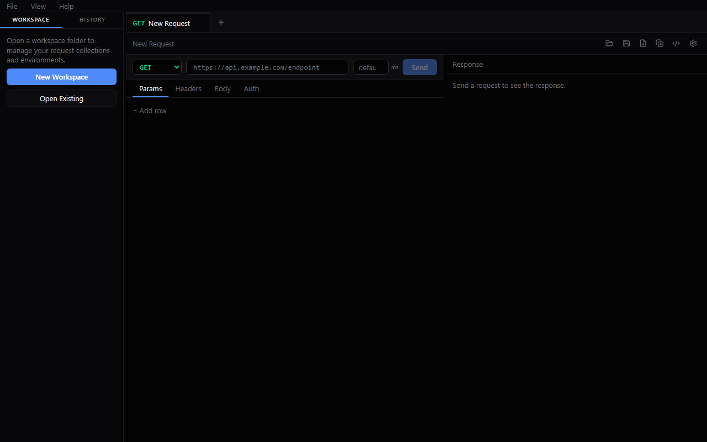
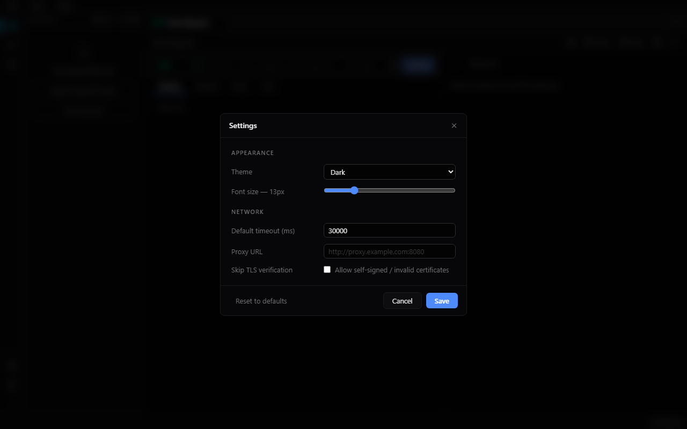
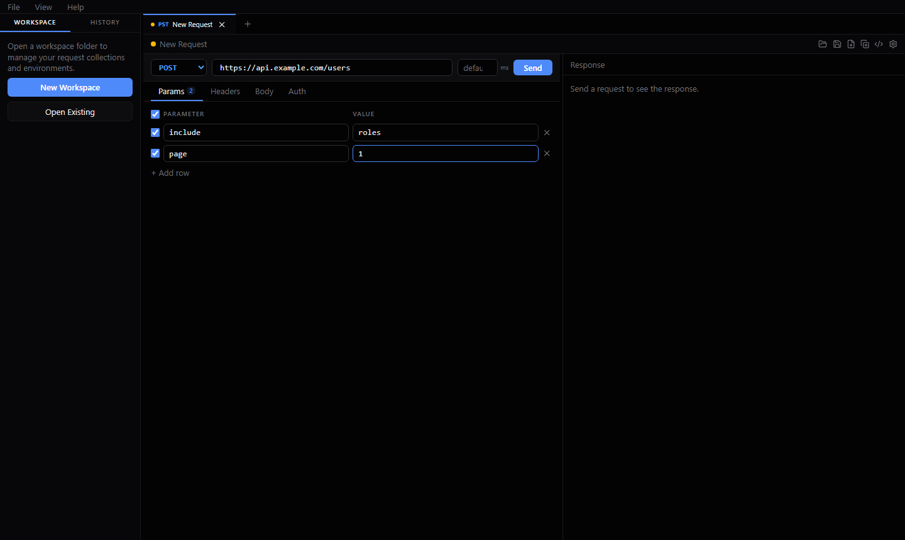
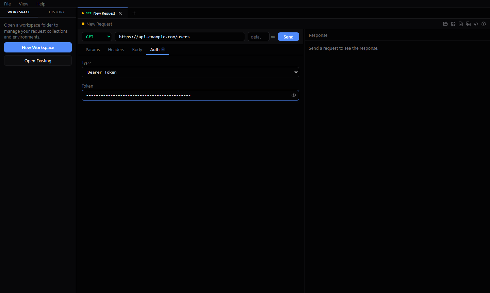
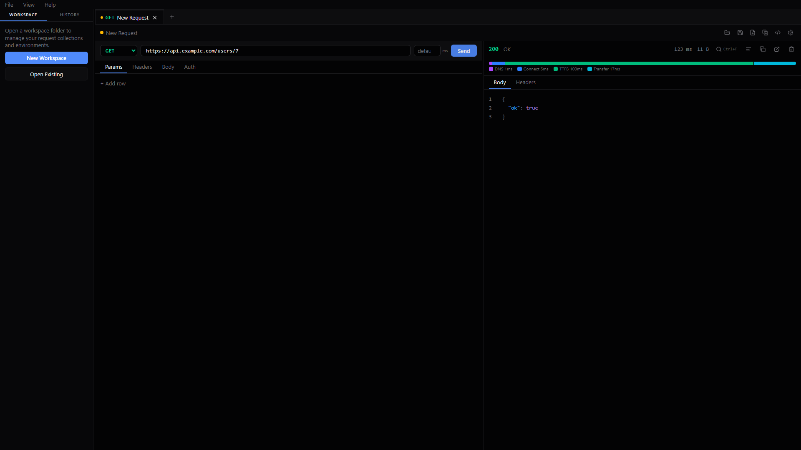
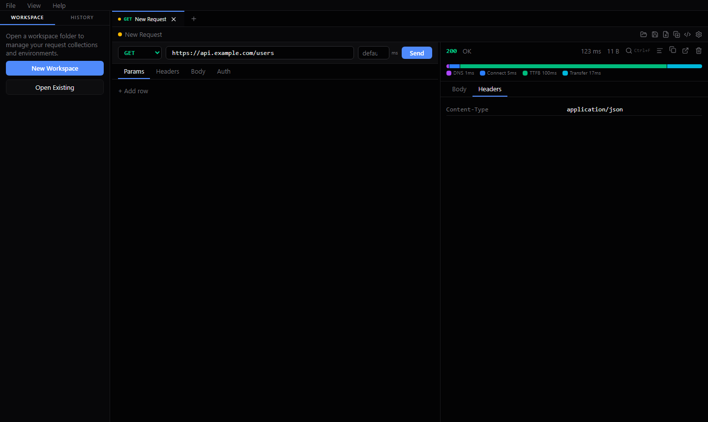
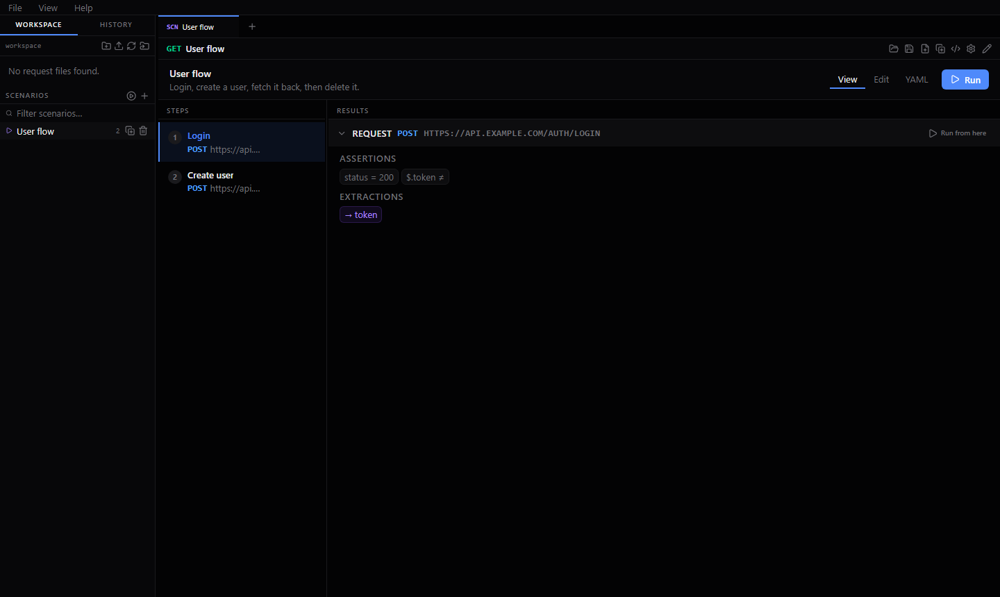
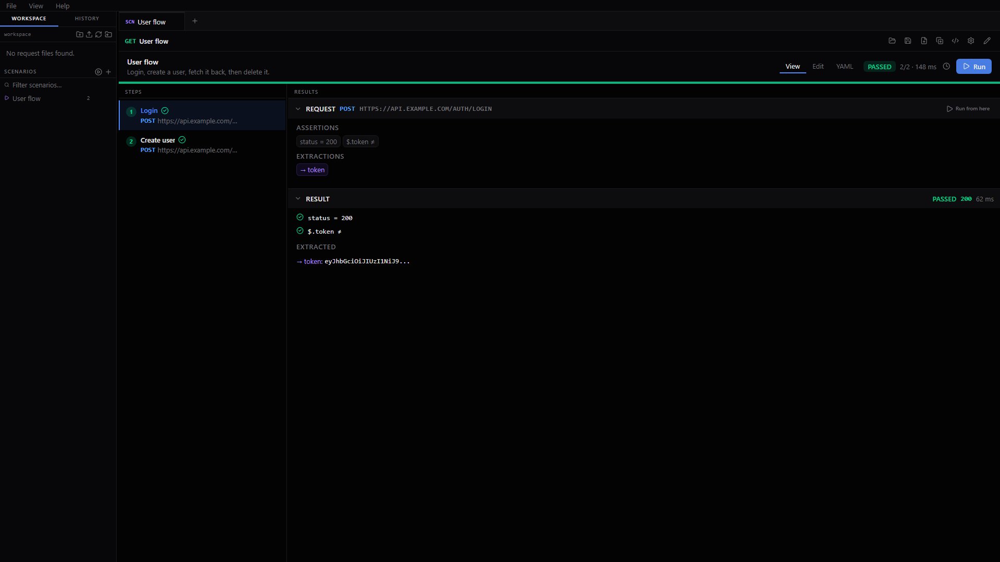
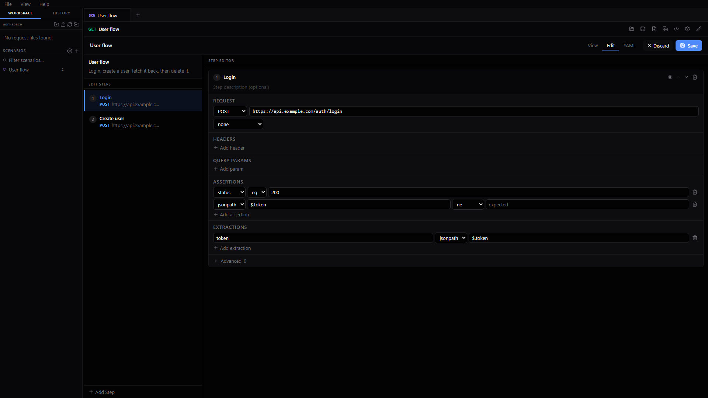

# ApiDesk

**API Contract Validation & Spec Conformance Testing**

A local-first, open-source platform for building, running, and validating API requests — from interactive exploration to fully automated CI/CD conformance gates.

- Desktop app (Windows, macOS, Linux)
- Headless CLI (`apidesk`)
- Zero accounts, zero cloud dependency

---

## Architecture

```
┌────────────────────────────────────────────────────┐
│  Desktop App (Wails + React)   CLI (Cobra)          │
├────────────────────────────────────────────────────┤
│           Application Services (Go)                │
├────────────────────────────────────────────────────┤
│  executor  │  scenario  │  conformance  │  openapi  │
│  variables │  assertions│  reporting    │  history  │
└────────────────────────────────────────────────────┘
            All shared Go core — no duplication
```

The Go core is the product. The desktop app and CLI are two interfaces to the same engine. HTTP execution, scenario evaluation, and schema validation all live in `packages/core` and are never re-implemented in the UI or CLI layer.

**Stack:** Go · Wails · React · TypeScript · Tailwind CSS · SQLite · OpenAPI 3.0/3.1

---

## Desktop UI



A three-panel layout designed for API development work.

```
┌──────────────┬──────────────────────────┬──────────────────────────┐
│   Sidebar    │     Request Editor       │     Response Viewer      │
│              │                          │                          │
│  Workspace   │  Method  URL       Send  │  200 OK  · 42ms · 1.2kb │
│  ├ requests/ │  ──────────────────────  │                          │
│  │ ├ login   │  Params  Headers         │  Timing bar              │
│  │ └ users   │  Body    Auth            │  DNS │ TCP │ TTFB │ Xfer │
│  └ envs/     │                          │                          │
│              │                          │  Body  Headers           │
│  History     │                          │  { "id": 1,  ...}        │
│  GET /users  │                          │                          │
└──────────────┴──────────────────────────┴──────────────────────────┘
```

- **Dark / light theme** with adjustable font size
- **Scenario editor** accessible from the sidebar
- **Settings panel** (gear icon): timeout, proxy, TLS skip-verify
- **OpenAPI import** button generates a full request collection from a spec file



---

## Requests





Every request is a plain YAML (or JSON) file. Portable, diffable, committable.

```yaml
schemaVersion: "1"
title: Create user
method: POST
url: "{{baseUrl}}/users"
auth:
  type: bearer
  token: "{{token}}"
body:
  type: json
  content: '{"name":"Alice","email":"alice@example.com"}'
```

**What you can configure:**

| Tab | What it controls |
|---|---|
| Params | Query parameters with per-row enable/disable toggle |
| Headers | Custom request headers |
| Body | None / JSON / Raw / Form-urlencoded; Format button for JSON |
| Auth | None / Bearer / Basic / API Key (header or query param injection) |

**Request editor conveniences:**
- Paste a URL containing `?foo=1&bar=2` — params are stripped and merged into the Params tab automatically
- Tab badges show a count (Params, Headers) or dot (Body, Auth) when anything is configured
- Send with Enter or the Send button





**Response viewer shows:**
- Status code, duration, and response size
- Chrome-style timing bar: DNS · Connect · TLS · TTFB · Transfer
- Syntax-highlighted JSON body
- Full response headers table

---

## Workspaces & Environments

A **workspace** is a directory on disk. No proprietary database format.

```
my-api/
├── requests/
│   ├── auth/
│   │   └── login.yaml
│   └── users/
│       ├── list-users.yaml
│       ├── create-user.yaml
│       └── get-user.yaml
├── environments/
│   ├── local.yaml
│   ├── staging.yaml
│   └── ci.yaml
└── scenarios/
    └── user-lifecycle.yaml
```

**Environments** hold named variables. Switch environments in the top bar; the active environment drives variable resolution in every subsequent request.

```yaml
schemaVersion: "1"
name: staging
variables:
  - name: baseUrl
    value: https://staging.example.com
  - name: token
    value: ""
    secret: true   # never written to history or reports
```

`{{variableName}}` placeholders work in URLs, headers, query params, body content, and auth fields. Secrets are redacted in request history, logs, and all report formats.

---

## Scenarios



A scenario is a multi-step API flow. Steps run sequentially; variables extracted from one response are available in all subsequent steps.

```yaml
schemaVersion: "1"
title: User lifecycle
description: Login, create a user, fetch it back, then delete it.
specFile: ../openapi.yaml   # optional — auto-validates every response

steps:
  - title: Login
    request:
      method: POST
      url: "{{baseUrl}}/auth/login"
      body:
        type: json
        content: '{"username":"{{username}}","password":"{{password}}"}'
    assertions:
      - type: status
        operator: eq
        expected: "200"
      - type: jsonpath
        path: "$.token"
        operator: ne
        expected: ""
    extractions:
      - name: token       # captured from response, available in all later steps
        source: jsonpath
        path: "$.token"
    failPolicy: stop      # stop | continue | skip

  - title: Create user
    request:
      method: POST
      url: "{{baseUrl}}/users"
      headers:
        - name: Authorization
          value: "Bearer {{token}}"   # value extracted above
      body:
        type: json
        content: '{"name":"Diana Prince","email":"diana@example.com"}'
    assertions:
      - type: status
        operator: eq
        expected: "201"
      - type: jsonpath
        path: "$.id"
        operator: gt
        expected: "0"
    extractions:
      - name: userId
        source: jsonpath
        path: "$.id"
```

**Assertion types:**

| Type | Example |
|---|---|
| `status` | `eq 200`, `lt 400` |
| `header` | `Content-Type contains json` |
| `jsonpath` | `$.user.name eq "Alice"` |
| `schema` | Validates body against an inline or spec-bound schema |

**Operators:** `eq` `ne` `gt` `lt` `contains` `matches`

**Spec binding:** Add `specFile:` to a scenario and every step's response is automatically validated against the OpenAPI spec — no manual `schema` assertions needed.

**Desktop scenario editor:** Visual step builder (add/remove steps, edit assertions, drag to reorder) or raw YAML mode. Run button executes the scenario and shows per-step pass/fail inline.





---

## HTTP RFC Conformance Scenarios

A correct HTTP status code is only part of the contract. Several RFCs mandate specific accompanying headers — headers that implementations routinely omit. ApiDesk ships ready-to-run example scenarios for each pattern.

### Why headers matter alongside status codes

| Status | RFC mandate | Missing header means… |
|---|---|---|
| `401 Unauthorized` | `WWW-Authenticate` (RFC 9110 §11.6.1) | Client can't determine which auth scheme to use |
| `405 Method Not Allowed` | `Allow` (RFC 9110 §15.5.6) | Client can't discover permitted methods |
| `429 Too Many Requests` | `Retry-After` + `X-RateLimit-*` (RFC 6585) | Client has no signal for when to retry |
| `503 Service Unavailable` | `Retry-After` (RFC 9110 §15.6.4) | Client retries blindly with no backoff hint |

### What the scenarios assert

Each scenario in `examples/scenarios/` tests the full header contract, not just the status code:

**401 — `WWW-Authenticate` required**
```yaml
- title: Request without token — expect 401 with WWW-Authenticate
  request:
    method: GET
    url: "{{baseUrl}}/protected"
  assertions:
    - type: status
      operator: eq
      expected: "401"
    - type: header
      path: "WWW-Authenticate"
      operator: contains
      expected: "Bearer"
```

**405 — `Allow` lists permitted methods**
```yaml
- title: GET on login endpoint — expect 405 with Allow header
  request:
    method: GET
    url: "{{baseUrl}}/auth/login"
  assertions:
    - type: status
      operator: eq
      expected: "405"
    - type: header
      path: "Allow"
      operator: contains
      expected: "POST"
```

**429 — Rate limit budget tracked across steps**
```yaml
- title: First failed login — expect 401 with remaining budget
  assertions:
    - type: status
      operator: eq
      expected: "401"
    - type: header
      path: "X-RateLimit-Remaining"
      operator: eq
      expected: "1"

- title: Third attempt — expect 429 with full header set
  assertions:
    - type: status
      operator: eq
      expected: "429"
    - type: header
      path: "Retry-After"
      operator: eq
      expected: "60"
    - type: header
      path: "X-RateLimit-Limit"
      operator: eq
      expected: "2"
```

**503 — Retry-After communicates backoff**
```yaml
- title: Maintenance endpoint — expect 503 with Retry-After
  assertions:
    - type: status
      operator: eq
      expected: "503"
    - type: header
      path: "Retry-After"
      operator: ne
      expected: ""
```

### Running the full conformance suite

```bash
# Start the included example server
go run ./examples/server

# Run all RFC conformance scenarios
apidesk run examples/scenarios/401-www-authenticate.yaml  --env examples/environments/local.yaml
apidesk run examples/scenarios/405-method-not-allowed.yaml --env examples/environments/local.yaml
apidesk run examples/scenarios/429-rate-limit.yaml         --env examples/environments/local.yaml
apidesk run examples/scenarios/503-service-unavailable.yaml --env examples/environments/local.yaml
```

These are plain YAML scenario files — copy them into your own workspace and point them at your API.

---

## OpenAPI Integration

**Import a spec** from the desktop UI (⇡ button in the workspace panel) or from the CLI:

```bash
apidesk generate openapi.yaml --base-url https://api.example.com
```

This generates one YAML request file per operation:
- Path parameters become `{{paramName}}` placeholders
- POST / PUT / PATCH operations get a JSON body stub
- Operations with security requirements get a `Bearer {{token}}` auth hint

**Response validation** runs automatically in `apidesk conform` and in any scenario with `specFile:` set. Validation uses kin-openapi and checks the response body against the declared schema for the matched status code.

**Breaking change detection:**

```bash
apidesk diff openapi-v1.yaml openapi-v2.yaml
```

Classifies every change as `ERR` (breaking), `WARN` (potentially breaking), or `INFO` (non-breaking). Breaking changes include: removed endpoints, added required parameters, removed response fields, changed field types, removed enum values, added auth requirements.

---

## API Contract Validation

ApiDesk's primary purpose is verifying that an API's actual runtime behaviour matches its declared OpenAPI contract. Three complementary tools cover the full conformance workflow.

---

### 1 — Automatic Spec Conformance (`apidesk conform`)

Parses a spec, executes every declared operation against a live server, and validates each response against the declared response schema — without writing a single test file.

```
                  openapi.yaml
                       │
                 parse + generate
                       │
              ┌────────▼────────┐
              │  for each op:   │
              │  1. build req   │
              │  2. execute     │
              │  3. validate    │
              │     response    │
              └────────┬────────┘
                       │
              per-operation result:
              PASS / FAIL (+ violations) / SKIP
```

What "conformance" means per operation:
- The server responded (no network error, no timeout)
- The response body matches the schema declared for that status code in the spec
- Required fields are present, types are correct, enum values are within range

**Coverage flag** shows which operations actually received a response vs. which were skipped or unreachable:

```
Coverage: 7 / 8 operations (88%)

Covered:   POST /auth/login  ·  GET /health  ·  GET /users  ·  ...
Not covered:  GET /protected
```

Filter by tag or path prefix to run conformance against a subset of the spec:

```bash
apidesk conform openapi.yaml --base-url https://api.example.com \
  --tags users,auth \
  --env environments/ci.yaml \
  --coverage \
  --format junit \
  --output results/conform.xml
```

---

### 2 — Scenario-Level Spec Binding

Bind a scenario to a spec file and every step's response is automatically validated against the spec's declared schema — no manual `schema` assertions needed in each step.

```yaml
schemaVersion: "1"
title: User lifecycle
specFile: ../openapi.yaml      # one line enables automatic validation

steps:
  - title: Create user
    request:
      method: POST
      url: "{{baseUrl}}/users"
      body:
        type: json
        content: '{"name":"Alice","email":"alice@example.com"}'
    assertions:
      - type: status
        operator: eq
        expected: "201"
    # No "schema" assertion needed here — specFile covers it
```

When `specFile` is set, the scenario runner calls `ValidateResponseByPath` after every step and appends any schema violations as failed assertion results. Steps can still carry explicit `schema` assertions for additional inline checks.

---

### 3 — Breaking Change Detection (`apidesk diff`)

Compares two spec versions and classifies every change. Used as a CI gate to prevent spec regressions from reaching consumers.

```bash
apidesk diff openapi-base.yaml openapi-pr.yaml
```

```
  [ERR] !  GET /users/{id}: response field "email" removed
  [ERR] !  POST /users: required request field "role" added
  [WARN]   PUT /users/{id}: response field "updatedAt" type changed
  [INFO]   POST /exports: new endpoint added

4 change(s)  ·  2 breaking
```

| Level | Meaning | Breaking? |
|---|---|---|
| `ERR` | Consumers will break without code changes | Yes |
| `WARN` | May break depending on client strictness | Potentially |
| `INFO` | Additive or documentation-only change | No |

**What counts as breaking:**

- Endpoint removed
- Required request parameter or field added
- Response field removed or renamed
- Response field type changed
- Enum value removed
- Auth requirement added to an operation

Exit code `1` when breaking changes are found — the PR is blocked automatically in CI.

---

### How the three fit together in a CI pipeline

```
On every PR
────────────────────────────────────────────────────────────
  apidesk diff main-spec.yaml pr-spec.yaml
  └── exit 1 if breaking → PR blocked before tests run

On merge to main (or nightly)
────────────────────────────────────────────────────────────
  apidesk conform openapi.yaml --base-url $STAGING_URL \
    --env environments/ci.yaml --coverage --format junit
  └── exit 1 if violations → build fails
  └── JUnit report published to CI dashboard

Scenario suite (per-service integration tests)
────────────────────────────────────────────────────────────
  apidesk run scenarios/user-lifecycle.yaml \
    --env environments/ci.yaml --format junit
  └── exit 1 if assertion failures → build fails
```

All three produce JUnit XML consumed natively by Jenkins, GitHub Actions, GitLab CI, and CircleCI.

---

## CLI

The `apidesk` CLI is the same Go core with a terminal interface. All three main commands produce machine-readable output and return meaningful exit codes.

### `apidesk run` — Execute a scenario

```bash
apidesk run scenarios/user-lifecycle.yaml \
  --env environments/ci.yaml \
  --format junit \
  --output results/scenario.xml
```

```
Scenario: User lifecycle

  PASS  Login          200  12ms
  PASS  Create user    201  18ms
  PASS  Fetch user     200  9ms
  PASS  Delete user    204  7ms

PASSED  4 passed, 0 failed, 0 skipped  (9/9 assertions passed)  46ms
```

Exit codes: `0` = all passed · `1` = assertion failures · `2` = parse or execution error

---

### `apidesk conform` — Spec conformance run

```bash
apidesk conform openapi.yaml \
  --base-url https://api.example.com \
  --env environments/ci.yaml \
  --tags users,auth \
  --format junit \
  --output results/conform.xml \
  --coverage
```

```
ApiDesk Example API  1.0.0
Base URL: http://localhost:8080

  PASS  POST    /auth/login         200  14ms
  PASS  GET     /health             200  6ms
  PASS  GET     /users              200  11ms
  PASS  POST    /users              201  19ms
  PASS  GET     /users/{id}         200  8ms
  FAIL  PUT     /users/{id}         200  missing required field "email"
  PASS  DELETE  /users/{id}         204  7ms
  SKIP  GET     /protected          —

FAILED  7 operations  ·  6 passed  ·  1 failed  ·  1 skipped  65ms

Coverage: 7 / 8 operations (88%)

Covered:
  POST    /auth/login
  GET     /health
  GET     /users
  ...

Not covered:
  GET     /protected
```

Flags: `--base-url` `--env` `--tags` `--paths` `--fail-fast` `--request-timeout` `--coverage`

Exit codes: `0` = all conform · `1` = violations found · `2` = spec/config error

---

### `apidesk diff` — Breaking change detection

```bash
apidesk diff openapi-base.yaml openapi.yaml --breaking-only
```

```
  [ERR] !  GET /users/{id}: response field "email" removed
  [ERR] !  POST /users: required request field "role" added
  [WARN]   PUT /users/{id}: response field "updatedAt" type changed

3 change(s)  ·  2 breaking
```

Exit codes: `0` = no breaking changes · `1` = breaking changes found · `2` = parse error

---

### `apidesk generate` — Generate request files from a spec

```bash
apidesk generate openapi.yaml --base-url https://api.example.com --output ./requests
```

### `apidesk request` — Execute a single saved request file

```bash
apidesk request requests/users/list-users.yaml --env environments/local.yaml --format json
```

### `apidesk validate` — Check scenario files for errors without running them

```bash
apidesk validate scenarios/*.yaml --format json
```

---

## CI/CD Integration

All three commands accept `--format junit` and `--output <file>`. JUnit XML is consumed natively by Jenkins, GitHub Actions, GitLab CI, and CircleCI — no plugins or adapters needed.

### GitHub Actions

```yaml
- name: Run API scenarios
  run: |
    ./apidesk run scenarios/user-lifecycle.yaml \
      --env environments/ci.yaml \
      --format junit \
      --output results/scenario.xml
  env:
    API_TOKEN: ${{ secrets.API_TOKEN }}

- name: Publish results
  uses: dorny/test-reporter@v1
  if: always()
  with:
    name: API Scenario Results
    path: results/scenario.xml
    reporter: java-junit

- name: Check for breaking changes
  run: ./apidesk diff openapi-base.yaml openapi.yaml
  # Exit code 1 blocks the PR
```

### Jenkins

```groovy
stage('API Conformance') {
    steps {
        sh './apidesk conform openapi.yaml --base-url ${API_BASE_URL} --format junit --output results/conform.xml'
    }
    post {
        always { junit 'results/conform.xml' }
    }
}
```

### GitLab CI

```yaml
api-scenarios:
  script:
    - ./apidesk run scenarios/user-lifecycle.yaml --env environments/ci.yaml --format junit --output results/scenario.xml
  artifacts:
    when: always
    reports:
      junit: results/scenario.xml
```

### Secrets

Use your CI platform's native secret store. Inject at runtime via an environment file — never commit files containing real values.

```bash
cat > environments/ci-runtime.yaml << EOF
schemaVersion: "1"
name: CI
variables:
  - name: baseUrl
    value: "${API_BASE_URL}"
  - name: token
    value: "${API_TOKEN}"
    secret: true
EOF

./apidesk run scenario.yaml --env environments/ci-runtime.yaml
```

ApiDesk never writes `secret: true` values to request history, logs, or reports.

---

## Summary

| Feature | Desktop | CLI |
|---|---|---|
| Send HTTP requests | ✓ | ✓ (`apidesk request`) |
| Params, headers, body, auth | ✓ | ✓ |
| Response timing breakdown | ✓ | — |
| Workspaces & collections | ✓ | — |
| Environments & variables | ✓ | ✓ (`--env`) |
| Request history | ✓ | — |
| Multi-step scenarios | ✓ | ✓ (`apidesk run`) |
| Variable extraction between steps | ✓ | ✓ |
| Assertions (status, header, jsonpath, schema) | ✓ | ✓ |
| RFC conformance scenarios (401/405/429/503) | — | ✓ (example scenarios) |
| Import OpenAPI spec | ✓ | ✓ (`apidesk generate`) |
| Generate request files from spec | ✓ | ✓ |
| Spec conformance run | — | ✓ (`apidesk conform`) |
| Coverage tracking | — | ✓ (`--coverage`) |
| Breaking change detection | — | ✓ (`apidesk diff`) |
| JUnit XML output | — | ✓ |
| Scenario validation (dry run) | — | ✓ (`apidesk validate`) |
| Settings (theme, proxy, TLS, timeout) | ✓ | flags |
